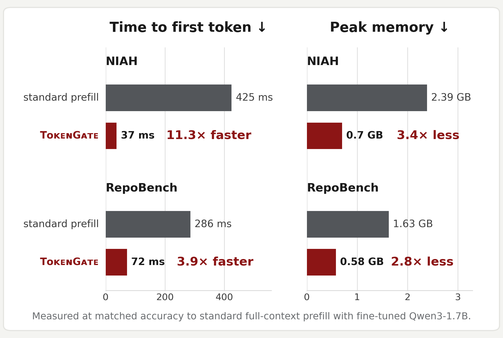
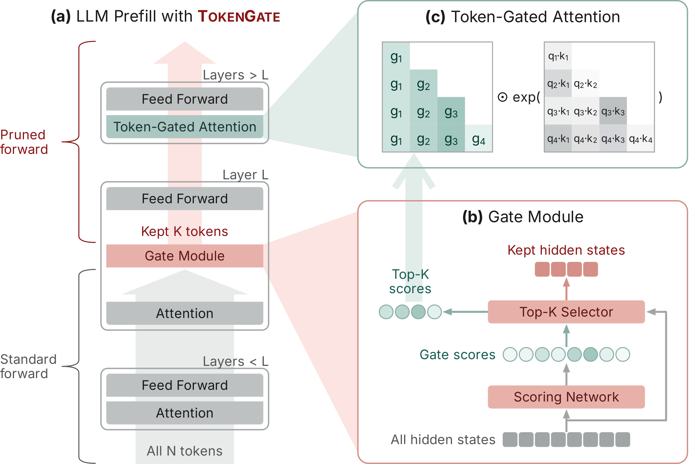

<p align="center"></p>

<p align="center"><b>TokenGate is a drop-in component that lets LLMs <I>skim, then read</i> long-context inputs for
fast and memory-efficient prefill.</b></p>

<p align="center">
<a href="https://arxiv.org/abs/2610.26754">Paper</a> ·
<a href="#-quick-start">Quick start</a> ·
<a href="#-how-it-works">How it works</a> ·
<a href="#-reproducing-results">Reproducing results</a>
</p>

## ⚡ Why TokenGate?

Current language models read all tokens of their input context, processing each one through all model layers. TokenGated Language Models can *skim*, selectively processing only context that matters through learned token selection for 11.3x faster prefill with 3.4x lower peak memory at no accuracy degradation. TokenGated Language Models achieve conditional computing, akin to MoE, but over a different scaling dimension: long-context inputs. 

TokenGate is a drop-in component that extends any existing model (e.g., trained transformers or hybrid architectures). You can use it as a replacement to standard fine-tuning or PEFT. While fine-tuning/PEFT allow models to improve task-specific accuracy, training models with TokenGate allows models to improve both accuracy *and prefill efficiency** for Pareto-optimal performance. Training with TokenGate is as simple and efficient as PEFT training.

<p align="center"></p>

## 📦 Installation

```bash
uv venv && uv pip install -e .     # Python ≥ 3.10, CUDA PyTorch ≥ 2.9; ".[train]" for training
```

Recommended: `python kernels/fa2bias/build.py` builds the fast
FlashAttention-2 key-bias kernel that the dense-Qwen3 defaults use (needs
`nvcc`). Everything also runs without it via FlexAttention: inference falls
back automatically with a warning; training asks for an explicit
`attn_backend="flex"` so a paper-recipe run is never silently slower.

## 🚀 Quick start

### Inference

The API mirrors the standard transformers flow (`from_pretrained` /
`apply_chat_template` / `generate`) — the differences are the import, the
`{state}` placeholder marking the prunable document (everything else in the
prompt is never pruned), and one extra parameter: `max_kept_prefill_tokens`,
the keep-budget K. Here with the released needle-in-a-haystack gate — a fact
planted somewhere in ~32,000 tokens of essays:

```python
from transformers import AutoTokenizer
from tokengate import load_model, apply_chat_template

# one object: base model + gate + paired adapter; gate layer and base model
# are read from the checkpoint's own metadata
model = load_model("liana313/tokengate-niah-qwen3-1.7b")
tok = AutoTokenizer.from_pretrained(model.base_model)

prompt = ("Answer the question using only the document below. "
          "Keep your answer short and direct.\n\n"
          "Question: What is the best thing to do in San Francisco?\n\n"
          "Document:\n{state}\n\nAnswer:")
ids = apply_chat_template(tok, prompt, state=open("essays.txt").read())

for k in (None, 2000, 500, 100):          # None = keep every state token
    out = model.generate([ids], tok, max_kept_prefill_tokens=k)
    print(k, f"{out.prefill_s * 1e3:5.0f} ms", out.answers[0])

# K      prefill   answer
# all    1471 ms   eat a sandwich and sit in Dolores Park on a sunny day
# 2000    153 ms   eat a sandwich and sit in Dolores Park on a sunny day
# 500     157 ms   eat a sandwich and sit in Dolores Park on a sunny day
# 100     130 ms   eat a sandwich and sit in Dolores Park on a sunny day
```

One gate serves every K: the planted needle is still answered verbatim with
144 of 32,191 prompt tokens (0.4%) in the KV cache, at ~11× lower
time-to-first-token.

### Training

Training looks like a TRL/PEFT recipe: a config object plus a trainer that
takes your dataset. The run-defining hyperparameters are required
(construction fails loudly on anything missing); the converged recipe —
Muon for the run and the gate, constant LR after warmup, LoRA on all layers,
SWA off — is the default. The Qwen3 defaults train on the key-bias kernel
from [Installation](#-installation); without it the trainer fails fast at
launch — set `attn_backend="flex"` in the config to train on the no-build
kernels instead.

Here training the needle-in-a-haystack gate the inference example runs
(generate the synthetic haystacks once with
`python datasets/niah_kamradt/generate_niah_kamradt.py --output-file niah.jsonl --n-train 12000`):

```python
import json
from tokengate import TokenGateConfig, TokenGateTrainer

niah = [json.loads(l) for l in open("niah.jsonl")]
rows = lambda split: [{"article": f"{r['body']}\n\nQuestion: {r['question']}",
                       "answer": r["answer"]}
                      for r in niah if r["split"] == split]

config = TokenGateConfig(
    base_model="Qwen/Qwen3-1.7B",
    gate_layer=1,                         # layer L whose hidden states the gate scores
    output_dir="e2e_gates/niah-1p7b",
    learning_rate=1e-4,
    epochs=20,
    k_eval=[2000],                        # in-training eval K sweep
    # LoRA co-adaptation (the backbone itself stays frozen)
    lora_rank=16, lora_alpha=32, lora_lr=1e-4,
    lora_targets=["q_proj", "v_proj"],
    wandb_project="token-gate",           # omit to disable logging
)
trainer = TokenGateTrainer(
    config,
    train_dataset=rows("train"),          # [{"article": ..., "answer": ...}, ...]
    eval_dataset=rows("test"),
    task="niah_kamradt",                  # registered prompt + metric (datasets/tasks)
)
trainer.train()                           # → e2e_gates/niah-1p7b/gate_final.pt
```

Each row is `{"article": <the prunable document>, "answer": <target>}`
(`"state"` works as an alias for `"article"`; any HF Dataset with those
columns works). The trainer tokenizes the rows into the standard store
layout, carves a deterministic eval split from `eval_dataset` (first
`eval_val_samples` sorted ids in-training, the rest reserved as a test
partition), and trains. Already-prepared data (the per-dataset `prepare.py`
layout under `datasets/`) can be passed by name instead —
`train_dataset="biodex/biodex_reactions"` — with no `eval_dataset`; the
store's own val split is used.

The gate trains against randomly sampled keep-budgets (the default
`phase2_loguniform` K source), so one trained gate serves any K at inference.
`train()` launches a DDP `torchrun` run on all visible GPUs (`num_gpus`
overrides) and blocks until the final gate and its name-paired LoRA land in
`output_dir`. Attention kernels resolve from the model family
(FlashAttention-2 + key-bias fork for dense Qwen3, FlexAttention for
Qwen3.5); set `attn_backend` explicitly for other models.

## 🔍 How it works

<p align="center"></p>

A gate module at an early layer *L* scores every token of the prunable input
(the **state**) and keeps the top-*K*. The layers above *L* process only
those *K* tokens and store only their KV-cache entries — pruned tokens never
consume compute or memory above the gate, which is where both the
time-to-first-token and the peak-memory savings come from. Everything outside
the `{state}` placeholder (instructions, the question, the generated answer)
is never pruned.

The gate trains end-to-end with plain next-token prediction. This is enabled
by **token-gated attention**, which re-weights attention logits by each
token's gate score so that gradients flow through the otherwise
non-differentiable top-*K* selection. Only the gate and a name-paired LoRA
adapter are trained — the backbone stays frozen, so the cost is comparable to
standard parameter-efficient fine-tuning. Because the gate trains against
randomly sampled keep-budgets, a single trained gate serves any *K* at
inference.

## 📊 Reproducing results

### Benchmark examples

`examples/niah_demo.py` downloads the trained gate for Qwen3-1.7B (gate
layer 1) from the Hub and runs the classic Kamradt needle-in-a-haystack on
committed ~32k-token Paul Graham essay haystacks: for each keep-budget it
reports retrieval accuracy, prefill time-to-first-token, and how much of the
needle sentence itself survived the pruning:

```bash
python examples/niah_demo.py                 # 5 haystacks, K = all/2000/500/100
python examples/niah_demo.py --k 500 --n 2   # one budget, fewer rows
```

Validated output (5 haystacks, needle depths 11–100%, one GPU):

```
 kept tokens    acc   TTFT(ms)  speedup  needle kept
------------------------------------------------------
         all   1.00     1533.6    1.00x        100%
        2000   1.00      153.4   10.00x        100%
         500   1.00      144.3   10.63x        100%
         100   1.00      137.2   11.18x        100%
```

Every needle is retrieved at every budget — even keeping 100 of ~32k tokens,
the gate's selection lands squarely on the needle sentence.

A second demo on real data follows the same pattern:
`examples/biodexr_demo.py` (BioDEX adverse-drug-reaction extraction; mean
exact-match set F1 0.622 at K=2000 over the committed val articles). Both
pipelines are covered by `python -m tokengate.e2e_gate.tests.test_niah_demo`
and `...tests.test_biodexr_demo`, and `--gate-attn flex` avoids the
custom-kernel build at some speed cost.

For a full accuracy + latency comparison against standard prefill,
`benchmarks/run_benchmark.py` measures, on the same samples and base model,
**accuracy** (the task's own metric) and **TTFT** (prefill-to-first-token,
batch size 1) for three arms: standard full prefill of the base model,
TokenGate with nothing pruned (the accuracy reference), and TokenGate at each
configured K. Each config in `benchmarks/configs/` (niah, repobench, biodexr)
pairs a released checkpoint with the prepared dataset's pinned eval split —
`--split val` is the 50-row in-training eval partition, `--split test` the
full reserved held-out partition:

```bash
python benchmarks/run_benchmark.py --config benchmarks/configs/niah.yaml --split test
```

Validated held-out **test** results (every reserved test row, batch 1, one
H100; `base` = the unmodified model with full prefill):

| dataset | n | metric | base | TokenGate (no pruning) | TokenGate @K=2000 | TTFT speedup @K=2000 |
| --- | --- | --- | --- | --- | --- | --- |
| NIAH (16k) | 150 | acc | 0.993 | 1.000 | 1.000 | 6.3× |
| RepoBench-P | 450 | ES | 0.285 | 0.587 | 0.550 | 3.8× |
| BioDEX-Reactions | 450 | F1 | 0.056 | 0.284 | 0.292 | 2.1× |

Tighter budgets trade little: NIAH stays at 1.000 acc down to K=100 (8.1×),
RepoBench holds 0.533 ES at K=500 (5.6×). The no-pruning arm doubles as the
fine-tuning reference — its gap to `base` is what the task-trained
gate+adapter add. The TTFT gap widens with context length (the paper's
1.4–11.3× range comes from the longer-context tiers). The 50-row `val`
partitions reproduce the same ordering (e.g. RepoBench 0.576/0.559,
BioDEX 0.377/0.368 unpruned/@K=2000).

Released checkpoints: the benchmark
set above plus `liana313/tokengate-2wikimqa-qwen3-1.7b`,
`liana313/tokengate-multinews-qwen3-1.7b`, and the hybrid-attention
`liana313/tokengate-niah-qwen3.5-2b` — each repo holds the exact gate+LoRA
checkpoint the paper's benchmarks used.

### Training the TokenGate model

The released checkpoints train from the lane configs under `train-scripts/`
(one script per dataset, gate layer 1 — each sets every hyperparameter of
its run and calls the shared driver). Install with the `train` extras (see
[Installation](#-installation)); the shell drivers read the interpreter from
`PYTHON` — point it at your venv (`export PYTHON=$PWD/.venv/bin/python`) —
and log to W&B (`wandb login`, or `WANDB_MODE=disabled`).

The trainer reads pre-prepped tokenized stores. For BioDEX-Reactions (the
official splits of
[BioDEX](https://huggingface.co/datasets/BioDEX/BioDEX-Reactions), ~11.5k
train articles):

```bash
# one-time download of the official dataset into the HF cache
python -c "import datasets; datasets.load_dataset('BioDEX/BioDEX-Reactions')"

# tokenize into {train,val}.pkl for the base model
python datasets/biodex/biodex_reactions/prepare.py

# train (the packed memory-mapped token store is built automatically at launch)
WANDB_PROJECT=<your-project> bash train-scripts/example/run_e2e_gate_biodexr_example.sh
```

Common overrides (environment variables; see the script for the full list):

```bash
NUM_GPUS=1    bash train-scripts/example/run_e2e_gate_biodexr_example.sh   # single GPU
MAX_STEPS=50  bash train-scripts/example/run_e2e_gate_biodexr_example.sh   # smoke run
```

Outputs land under `e2e_gates/<model>/<run-name>/baseline/L<layer>/`:
`gate_final.pt` + `lora_final.pt` (and SWA variants), periodic resumable
checkpoints, `params.json`, and training-curve CSVs/plots. During training
the model is evaluated every `EVAL_FREQ` steps on the pinned val split and
the reserved held-out test split, at each K in `K_EVAL_VALUES`, alongside
no-compression and random-selection reference baselines. The released demo
checkpoint was trained with exactly this config. (For a synthetic dataset
with no external download, see the NIAH lanes:
`datasets/niah_kamradt/generate_niah_kamradt.py`.)

## 📚 Dataset interface

Each dataset is a directory `datasets/<dataset>/<task>/` with a
`prepare.py` that emits rows of `{article (the state), answer, id, metadata}`
and tokenizes them into `tokenized/<model>/{train,val}.pkl`. A training run
pins its dataset through a YAML manifest
(`tokengate/datasets/manifests/iso_<target>.yaml`) and pins its val/test
split through an eval-split manifest — the explicit source of eval-set sizes.
Scoring lives in `tokengate/datasets/tasks/` (one `Task` class per task: prompt
format, metric, judge config).

## 📁 Repo layout

| Path | What it is |
| --- | --- |
| `tokengate/` | the installable package: gate module, patched attention, trainer, decode |
| `tokengate/datasets/` | dataset lib (loaders, manifests, eval splits, sampling maps) + `tasks/` (per-task prompting + scoring) |
| `datasets/` | per-dataset `prepare.py` scripts and their tokenized stores (data, not a package) |
| `examples/` | runnable demo on a released checkpoint + sample data |
| `train-scripts/` | lane configs + the shared driver (`run_e2e_gate_pretrain.sh`, `e2e_gate_lib.sh`) and multi-node launchers |
| `kernels/fa2bias/` | FlashAttention-2 per-key-bias fork (training + inference kernel) |
| `benchmarks/` | accuracy + TTFT benchmark vs standard prefill (script + per-dataset configs) |

## 📄 Citation

Paper: [TokenGate: Adapting LLMs for Fast and Memory-Efficient Prefill with
Learned Token Pruning](https://arxiv.org/abs/2610.26754)

```bibtex
@article{patel2026tokengate,
  title={TokenGate: Adapting LLMs for Fast and Memory-Efficient Prefill with Learned Token Pruning},
  author={Patel, Liana and Ranjan, Rishabh and Stoica, Ion and Zaharia, Matei and Guestrin, Carlos},
  journal={arXiv preprint arXiv:2610.26754},
  year={2026}
}
```
